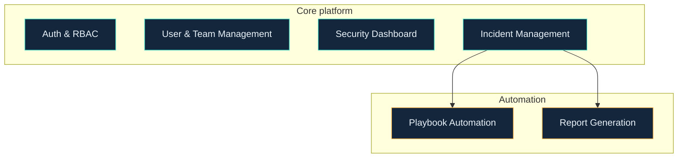

  

  
  

## What I'm working on

<table>
  <tr>
    <td width="33%" valign="top"><b>Building</b> A cloud security monitoring system with incident management, as team lead in the Infosys Springboard Virtual Internship (Java domain).</td>
    <td width="33%" valign="top"><b>Learning in public</b> Java, Spring Boot and React, one finished module at a time.</td>
    <td width="33%" valign="top"><b>Exploring</b> Where AI, full-stack development and UI/UX meet.</td>
  </tr>
</table>

## Featured project

### [Cloud Security Monitoring System with Incident Management Assistance](https://github.com/DHANUSHKA104/cloud-security-monitoring-system)

A platform that helps teams monitor cloud security events and handle incidents, with playbook automation and report generation.

**Role:** team lead. **Status:** in active development.

## More projects

<table>
  <tr>
    <td width="33%" valign="top"><b><a href="https://github.com/DHANUSHKA104/DKS-CareerMind-AI">DKS-CareerMind-AI</a></b> AI career guidance agent for students.</td>
    <td width="33%" valign="top"><b><a href="https://github.com/DHANUSHKA104/GMIRE-AI-Infrastructure-Failure-Prediction">GMIRE</a></b> Predicts infrastructure pipeline failures with machine learning.</td>
    <td width="33%" valign="top"><b><a href="https://github.com/DHANUSHKA104/ClassOrbit">ClassOrbit</a></b> AI-powered academic resource planner.</td>
  </tr>
</table>

## Highlights

| When | What | Detail |
|---|---|---|
| 2026 | **INNOVISION 2026**, V.S.B. Engineering College | 3rd place, Paper Presentation |
| 2026 | **Infosys Springboard** Virtual Internship 7.0 | Ongoing |
| Aug to Sep 2026 | **Pega National Internship Program** | 60 hours, completed |
| Aug 2026 | **Women Who Master Hackathon** (Logitech × Aspire For Her) | Zonal Round participant, Bengaluru |

<i>Ship small. Document properly. Keep improving.</i>

