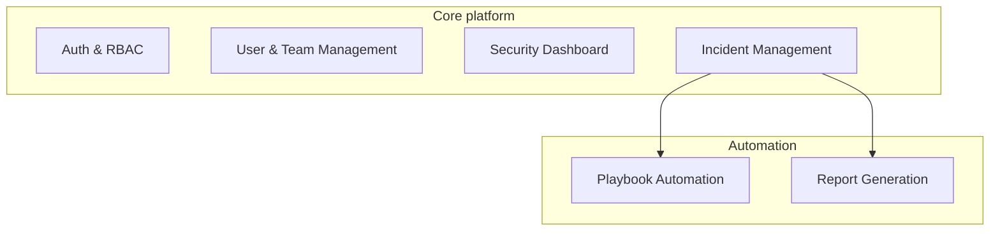

# Dhanushka K S

**ECE student building AI and cloud-security tools. Solo, zero-budget, learning in public.**

V.S.B. Engineering College, Karur · Tamil Nadu, India

---

## 🔭 Right now

- 🛡️ Leading a team on a **Cloud Security Monitoring System** for the Infosys Springboard Virtual Internship (Java domain)
- 📚 Learning in public: **Java · Spring Boot · React**
- 🎯 Interested in where **AI, full-stack development and UI/UX** meet

---

## ⭐ Featured project

### [Cloud Security Monitoring System with Incident Management Assistance](https://github.com/DHANUSHKA104/cloud-security-monitoring-system)

A platform that helps teams monitor cloud security events and handle incidents, with playbook automation and report generation.

**Stack:** Java · Spring Boot · ReactJS · Python  
**Role:** Team lead · **Status:** 🚧 In active development

---

## 🧩 More projects

| Project | About |
|---|---|
| [**DKS-CareerMind-AI**](https://github.com/DHANUSHKA104/DKS-CareerMind-AI) | AI career guidance agent for students |
| [**GMIRE**](https://github.com/DHANUSHKA104/GMIRE-AI-Infrastructure-Failure-Prediction) | Predicting infrastructure pipeline failures with machine learning |
| [**ClassOrbit**](https://github.com/DHANUSHKA104/ClassOrbit) | AI-powered academic resource planner |

---

## 🏆 Highlights

| | Where | Detail |
|---|---|---|
| 🥉 | **INNOVISION 2026**, V.S.B. Engineering College | 3rd place, Paper Presentation |
| 💼 | **Infosys Springboard** Virtual Internship 7.0 | Ongoing |
| 💼 | **Pega National Internship Program** | 60 hours, completed Sep 2026 |
| 🌐 | **Women Who Master Hackathon 2026** (Logitech × Aspire For Her) | Zonal Round participant, Bengaluru, Aug 2026 |

---

*Ship small. Document properly. Keep improving.*

